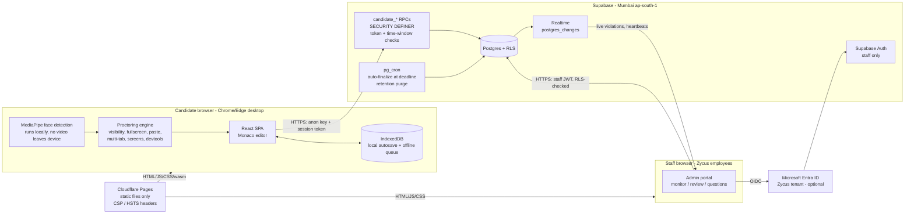

# Zycus CodeArena: Phase 0 Architecture Plan

*Hands-On Engineering Assessment · Draft v0.1 · 2026-10-09 · Status: **awaiting approval***

---

## 0. TL;DR

| | Recommendation |
|---|---|
| **Frontend** | React 18 + Vite + TypeScript + Tailwind CSS, **static** build. Monaco and MediaPipe are bundled and self-hosted. |
| **Hosting** | **Cloudflare Pages (Free)**: static, never sleeps, commercial use allowed, security headers via a `_headers` file. |
| **Backend** | **Supabase Free, region South Asia (Mumbai)**: Postgres + RLS + RPC functions + Realtime + Auth (staff only) + `pg_cron`. |
| **Candidate auth** | No accounts. An access code + email returns an **opaque server-side session token** that never expires mid-test, with nothing to refresh. |
| **Staff auth** | Preferred: **Sign in with Microsoft** (Entra ID, Zycus tenant only). Fallback: email + password + TOTP MFA for pre-created `@zycus.com` users. Both are gated by a DB allow-list. |
| **Code execution** | Off by default. Optional sandboxed Web Worker for JS/TS snippets. Extension point for a self-hosted Judge0/Piston later. |
| **Running cost** | ₹0. No paid APIs, and no service in this design needs a credit card. |

The biggest operational gotcha is that **Supabase Free pauses a project after 7 days of inactivity**. It never pauses mid-test, because the test itself is activity. The mitigations are an admin **pre-test health check**, a documented restore procedure, and an optional keep-alive ping (see §5).

---

## 1. Brand (Step 0 results)

Full detail and per-value provenance: [`BRAND_SOURCES.md`](../BRAND_SOURCES.md).

- zycus.com ships its own design tokens (`--zy-primary #0B1F3F`, `--zy-accent #0036B0`, `--zy-accent-dark #002A8C`, `--zy-bg-light #F7F9FC`, `--zy-border #E2E8F0`, `--zy-text #2D2D2D`, `--zy-gold #F5A623`, `--zy-green #2ECC71`). These were copied verbatim, not guessed.
- Additional brand blues come from computed styles: `#003DA5` (page titles), `#002D72`, `#0759E6`, the hero gradient `#0546D9 → #00267D`, and the "Merlin" spectrum gradient.
- **Font: Inter** (OFL, self-hosted). Style cues are pill buttons (radius 50px), 2px outlined CTAs, light large titles in brand blue, and a white header carrying the full-color logo.
- **Logo**: official 500×99 WebP only. There is **no official SVG publicly available**, so we will ask Marketing.
- WCAG: gold, green, teal and cyan fail as text on white, so they are restricted to accents and icons. The site's grey `#808080` (3.95 : 1) is replaced by `#526670` (6.01 : 1).

---

## 2. Architecture



### Components

| Layer | Choice | Why |
|---|---|---|
| UI framework | React 18, Vite 6, TypeScript (strict), React Router, Zustand | Mainstream and easy to hand over to another Zycus engineer |
| Styling | Tailwind CSS with all colors as CSS variables in `src/design/tokens.css` | One-file theme changes for Marketing |
| Editor | `monaco-editor` bundled locally via `@monaco-editor/react` + `loader.config({ monaco })` | The default loads from a CDN, and bundling locally avoids that runtime dependency and allows a strict CSP. Covers JS/TS/JSX/TSX/Java/XML/YAML/JSON/properties/Gradle (Groovy-like) |
| Markdown | `react-markdown` + `remark-gfm` + `rehype-sanitize`, with raw HTML disabled | XSS-safe rendering of question content |
| Local persistence | IndexedDB (`idb-keyval`) | Survives refresh and crash, with enough capacity for code plus the replay log |
| Compression | `fflate` | Compresses keystroke-replay chunks and builds the ZIP export |
| Face detection | `@mediapipe/tasks-vision` FaceDetector (BlazeFace short-range), wasm + model self-hosted under `/public/mediapipe/` | Free and fully client-side. `face-api.js` is unmaintained |
| PDF report | `jsPDF` (client-side) | No server, ₹0 |
| Backend | Supabase: Postgres 15+, PostgREST, Realtime, Auth, `pg_cron`, `pgcrypto` | One free service covers DB, auth, realtime and scheduled jobs |
| Hosting | Cloudflare Pages | Static files are served from the CDN, so there is no server to sleep. Commercial use is permitted on Free (see §5) |

---

## 3. Key design decisions

### D1. Candidates get no accounts, only an opaque server-side session token

- `candidate_login(code, email)` checks the **hashed** access code, the email, and the invitation's validity window. It then returns a random 256-bit token. The database stores only `sha256(token)`.
- Every candidate RPC takes that token and re-validates it server-side: the session matches, the status allows the action, and `now()` is before the deadline.
- **Why not Supabase anonymous auth or JWTs?** A JWT expires (default 1h) and has to be refreshed. A refresh that fails at minute 92 on a flaky network is exactly the failure we must not have. An opaque token has nothing to refresh. It stays valid until the session is finalized plus a grace period for submit retries, which covers the ≥ 4 h requirement.
- **Re-login policy** (proposed): the same code + email may log in again while the session is in progress, which is needed for crash recovery or a browser change. Each re-login **rotates the token**, invalidates the old tab or device (it receives `SESSION_SUPERSEDED` and locks), and is logged as a `session_takeover` violation. After submission the code is consumed for good.

### D2. One validated write path for candidates: `candidate_sync`

- Every 10 s (configurable to 10–15 s), and on demand, a single RPC carries:
  - changed files
  - notes
  - question statuses
  - buffered proctoring events
  - keystroke-replay chunks
  - heartbeat data
- The response returns the server time, the deadline, the session status and any admin messages.
- **Why one RPC:** a candidate cannot block violation reporting without also blocking their own saves.
- The server rejects any content write after `deadline + save_grace` (default 10 s, which covers only in-flight network latency).
- A separate 30 s heartbeat runs when nothing else is being sent.

### D3. Server-authoritative timer that ignores the system clock

- The server stores `started_at` (DB `now()`), `duration_s` and `extension_s`, and `deadline` is computed in the DB.
- The client estimates server time as `serverNow + (performance.now() − t₁)`, re-anchoring on every sync using the lowest-RTT sample.
  - `performance.now()` is monotonic, so changing the Windows clock has no effect.
- After a refresh the client simply asks for the deadline again, so the remaining time is exact.
- **Auto-submit at 0:**
  - The client locks the editor and submits.
  - Independently, a `pg_cron` job finalizes any overdue session every minute. It records `submitted_at = deadline` and reason `time_up`.
  - Saves are already refused after the deadline, so the result is the same whether or not the client cooperates.

### D4. Question content is frozen per session, and secrets live in separate tables

- When a test starts, its questions (statement + starter files) are copied into `session_questions`. Later edits to the question bank never change a running or finished assessment, and the reviewer diff always compares against exactly what the candidate received.
- `question_solutions` and `question_rubric_items` are **separate tables** that only admins and reviewers can read through RLS. Candidate RPCs select explicit columns from a different table, so a coding mistake cannot leak a solution through a `select *`.

### D5. Webcam snapshots are stored in Postgres (`bytea`), not Supabase Storage

- Snapshots are 320×240 JPEG at q≈0.6, about 10–15 KB each. At one every 150 s plus one per violation, that is about **1–1.5 MB per candidate**.
- Supabase's docs say Storage objects must be deleted via the Storage API, not SQL ([Delete Objects](https://supabase.com/docs/guides/storage/management/delete-objects)). A `pg_cron` retention job or a "delete candidate data" action therefore could not clean up Storage atomically. Keeping blobs in Postgres makes erasure a single cascading transaction with RLS on every byte.
- Image blobs sit in a separate table that is not published to Realtime. Only metadata streams to the live monitor.
- **Extension point:** if volume grows, an Edge Function can move snapshots to a private Storage bucket.

### D6. Staff access is restricted to Zycus in three layers

1. **Identity:** Entra ID single-tenant app registration (Zycus tenant only), or, in fallback mode, users pre-created by a Super Admin with sign-ups disabled.
2. **Domain check** in SQL: the email must match an allowed domain from config (`zycus.com`, `*.zycus.com`). Note that your own address is on `corpteam.zycus.com`, so subdomains must be allowed.
3. **Allow-list:** a row must exist in `staff_users` with a role (`super_admin` / `recruiter` / `reviewer`). Without one, a Zycus employee who signs in sees "Access not granted" and RLS returns nothing.

### D7. No runtime third-party CDNs

- Fonts, Monaco, MediaPipe wasm and the face model are all served from our own origin.
- The CSP therefore only needs `'self'` plus the Supabase project URL, and the test cannot break because an external CDN is slow or blocked by a corporate proxy.

### D8. Testing without Docker

Docker is not installed on this machine, so `supabase start` is not available.

| Layer | Tool | Covers |
|---|---|---|
| Unit | Vitest + Testing Library | Timer math, violation policy, paste guards, autosave queue, replay reconstruction |
| **DB / RLS / RPC** | **PGlite** (Postgres compiled to WASM, runs in Node) with small shims for Supabase's `auth.uid()` / roles | Every policy is checked as `anon`, as `authenticated` with each role, and through the candidate RPCs. Runs in CI with no Docker. RLS works in PGlite ≥ 0.2.9, but `SET ROLE` switching is not covered by PGlite's own tests, so the first thing I build is a smoke test proving that policies actually deny. If it fails, I fall back to one PGlite instance per role (its `username` option), and the staging-project tests remain the final gate |
| API-level RLS | Playwright/Node script against a **staging** Supabase project (the free plan allows 2 projects) | "A candidate calling the API directly cannot read solutions." Uses only the anon key |
| E2E | Playwright (Chromium/Chrome/Edge) with `--use-fake-device-for-media-stream` and the `page.clock` API | Paste blocking, tab switch, refresh-resume, offline 2 min, time-up auto-submit, a full 150-min run in accelerated time |
| 150-min simulation | Staging-only `debug_shift_session_time` RPC (disabled in prod by a config flag) + `page.clock.fastForward` | Exercises every autosave, heartbeat, snapshot and warning cycle across 150 minutes in about 10 minutes of wall-clock time |

---

## 4. Reliability: the 150-minute guarantee, risk by risk

| Risk | Mitigation |
|---|---|
| Static host sleeps / cold start | Cloudflare Pages is a CDN with no server process |
| DB paused | A test generates activity, so pausing cannot happen mid-test. Admin health check before inviting. Optional keep-alive. Restore runbook |
| Token / session expiry | Opaque token with no expiry before `deadline + grace` (D1). Staff JWTs refresh normally; staff are not on the critical path |
| Network drop (2 min+) | Every change is written to IndexedDB (debounced 300 ms). The sync queue holds the latest file states plus append-only events. An "Offline — your work is saved locally" banner shows. The queue flushes in order on reconnect, and the server dedupes by `client_seq` |
| Refresh / crash / browser restart | The token, files, open question, cursor and timer are restored from IndexedDB plus the server. The server copy wins if it is newer; otherwise local wins. `beforeunload` warns |
| Laptop / screen sleep | Screen Wake Lock, re-acquired on `visibilitychange`. The timer re-anchors on wake. Lid-close cannot be prevented; it is logged as a gap |
| System clock changed | Monotonic clock + server offset (D3) |
| Time-up while offline | Editor locks at the local deadline. Submit retries with exponential backoff. **Encrypted backup download** (AES-256-GCM, per-session key held server-side) that an admin can import. The import shows a diff against the last server-synced state, so reviewers can see exactly what arrived late |
| Double submit / retries | `candidate_submit` is idempotent (idempotency key + status check) |
| Admin force-submit / extend time while candidate offline | State is server-side, and the candidate client applies it on its next sync |
| Supabase API rate limits | Load is about 1 RPC / 10 s plus a 30 s heartbeat for one candidate, which is trivial (verified in §5) |

---

## 5. Free-tier verification (current limits, terms and gotchas)

> Checked on **2026-10-09** against official pricing pages, docs and terms (sources linked).
> Items marked **UNVERIFIED** were not stated explicitly in official docs. Each one has a check that runs at setup time.

### 5.1 Chosen services

| Service | Free-tier facts that matter to us | Our usage | Verdict |
|---|---|---|---|
| **Supabase Free** ([pricing](https://supabase.com/pricing), [billing](https://supabase.com/docs/guides/platform/billing-on-supabase)) | 500 MB DB per project (read-only when exceeded) · 1 GB storage · 5 GB egress + 5 GB cached · 50k MAU · Realtime 200 concurrent connections, 2M msgs/mo, 256 KB/msg · 500k Edge Function calls · "unlimited API requests" · **2 active free projects** (counted across all orgs you own/admin) | ≈1,200 requests and ~2–4 MB stored per candidate. Hundreds of candidates fit, given retention | ✅ |
| **Cloudflare Pages Free** ([limits](https://developers.cloudflare.com/pages/platform/limits/), [pricing](https://developers.cloudflare.com/pages/functions/pricing/)) | "Requests to static assets are free and unlimited" · 500 builds/mo · 20,000 files · 25 MiB per file · 100 custom domains · `_headers` (100 rules) and `_redirects` supported · commercial use not restricted ([terms](https://www.cloudflare.com/terms/)) | A few hundred files; MediaPipe wasm ≈ 10 MB, under the 25 MiB limit | ✅ |
| **Microsoft Entra ID** (optional) ([pricing](https://www.microsoft.com/en-us/security/business/microsoft-entra-pricing)) | Entra ID Free (included with M365) covers SSO; an app registration costs nothing | One single-tenant app registration | ✅ optional |
| **GitHub** (Zycus org) | See §5.4 | Repo + CI | ✅ |

### 5.2 Gotchas that matter to Zycus

| # | Gotcha | Impact | Mitigation in this design |
|---|---|---|---|
| G1 | **Supabase pauses Free projects** that lack "sufficient database activity over the past week". There is an email warning about 1 week before ([docs](https://supabase.com/docs/guides/platform/free-project-pausing)). Resume via Dashboard → *Resume project*. Restorable for **up to 1 year** after pausing; older docs said 90 days, so trust the dashboard countdown | If nobody uses the platform for a week, the first login fails until the project is resumed | (a) The admin **Pre-test health check** must be green before an invite is sent. (b) A restore runbook in SETUP_AND_DEPLOY.md. (c) **Optional keep-alive**: a free Cloudflare Worker cron (5 per account on Free) or a GitHub Actions cron calls a read-only `keepalive()` RPC every ~2 days. Supabase's Terms and AUP ([AUP v1, 2026-06-01](https://supabase.com/aup)) **neither allow nor forbid** this explicitly (UNVERIFIED). Note: `pg_cron` cannot keep the project awake, because it runs inside the paused DB |
| G2 | **No backups on Free.** Daily backups and PITR are Pro+ only ([docs](https://supabase.com/docs/guides/platform/backups)) | A corrupted or deleted DB cannot be restored by Supabase | (a) Results are exported (PDF + ZIP) and filed in the ATS / SharePoint after each assessment. This is the record of truth. (b) An optional **manual monthly `pg_dump`** by the Super Admin to a Zycus-controlled location (needs the free PostgreSQL client tools, not Docker). We will **not** push automated dumps to GitHub artifacts, because they contain candidate PII and would leave India |
| G3 | **SOC 2 Type 2 / ISO 27001 reports are Team plan and above only** ([docs](https://supabase.com/docs/guides/security/soc-2-compliance)) | InfoSec may ask for SOC 2 evidence, which Free cannot provide | Raise this early with InfoSec. The DPA is published for all customers ([DPA, v1 2026-08-01](https://supabase.com/legal/dpa)); whether it can be countersigned on Free is UNVERIFIED. If SOC 2 is mandatory, the documented upgrade path is Supabase Team (paid), and nothing else in the design changes |
| G4 | **Breaking change on 2026-10-30:** new `public` tables are **not exposed to the Data API without explicit GRANTs** ([changelog](https://supabase.com/changelog/45329-breaking-change-tables-not-exposed-to-data-and-graphql-api-automatically)) | Code written to old defaults gets error 42501 | Fits our design. Every migration states its GRANTs explicitly, and `anon` gets **no** table grants at all |
| G5 | **Built-in Supabase email only sends to project team members, 2 emails/hour**, "not meant for production" ([docs](https://supabase.com/docs/guides/auth/auth-smtp)) | Magic-link/OTP login for staff won't work without custom SMTP | Fallback staff login is **email + password + TOTP MFA** for users the Super Admin creates in the dashboard (no email needed). Optional: custom SMTP via Zycus M365, if IT allows |
| G6 | Supabase Auth has **no built-in email-domain restriction** | Without a check, anyone could create a staff auth user | A **"Before User Created" Auth Hook** (available on Free) rejects non-Zycus domains ([docs](https://supabase.com/docs/guides/auth/auth-hooks/before-user-created-hook)), and the DB allow-list (D6) applies on top |
| G7 | **Entra can emit unverified email domains**; Supabase recommends the `xms_edov` optional claim ([docs](https://supabase.com/docs/guides/auth/social-login/auth-azure)) | An identity-spoofing risk if email alone is trusted | Single-tenant Tenant URL + `xms_edov` + allow-list |
| G8 | **Entra client secret maximum is 24 months** (Microsoft recommends < 12) ([docs](https://learn.microsoft.com/en-us/entra/identity-platform/how-to-add-credentials)) | Staff SSO stops working when the secret expires | HANDOVER.md includes a rotation runbook. The health check warns about the expiry date stored in config |
| G9 | Entra "Assignment required" with **group** assignment needs P1/P2. Individual user assignment works on Free ([docs](https://learn.microsoft.com/en-us/entra/identity/enterprise-apps/assign-user-or-group-access-portal)) | Can't restrict the app to an AD group for free | Not needed. The DB allow-list is the real gate. IT may still assign individuals |
| G10 | Cloudflare docs now say "**start new projects with Workers**", though Pages is still supported ([Pages](https://developers.cloudflare.com/pages/)) | Pages may get fewer new features | **Stay on Pages:** a Workers custom domain requires the zone to be on Cloudflare, whereas Pages accepts a **CNAME from external DNS**, which is what `codearena.zycus.com` needs ([docs](https://developers.cloudflare.com/pages/configuration/custom-domains/)). Add the domain in Pages *before* creating the CNAME (otherwise 522), and CAA records must allow Cloudflare's CAs |
| G11 | Supabase free-tier compute is shared (Nano) and "subject to change" | Performance is best-effort, with no SLA | The load is tiny (one candidate). Local-first autosave makes the backend non-blocking for typing |
| G12 | Log retention on Free is 1 day | Supabase API logs can't be used for long-term forensics | Our own `audit_log` and `proctor_events` tables are the durable record |
| G13 | UNVERIFIED in docs: `pg_cron` and `pgcrypto` on Free, and Mumbai selectable on Free | The design depends on them | The setup guide verifies each (Mumbai in the create dialog; `create extension` statements in migration 0001). The health check confirms the cron jobs are running |

### 5.3 Rejected options

| Option | Why rejected |
|---|---|
| **Vercel Hobby** | "Hobby teams are restricted to **non-commercial personal use only**", which explicitly includes code written by "a paid employee" ([fair use](https://vercel.com/docs/limits/fair-use-guidelines)). A Zycus internal tool is commercial use and would breach the terms |
| **Netlify Free** | Credit-based: 300 credits/mo, **15 credits per production deploy** (≈20 deploys burn the month), and when credits run out, **all projects in the team are paused** ([docs](https://docs.netlify.com/manage/accounts-and-billing/billing/resume-paused-projects/)). That is an unacceptable risk for scheduled interviews |
| Render / Railway / Fly free web services | Spin down on idle or have no permanent free tier. Excluded from the critical path, as the brief requires |
| Supabase anonymous sign-ins for candidates | JWT refresh on the critical path, a 30/hour/IP limit, and CAPTCHA recommended. The opaque-token design (D1) avoids all of it |
| Public Judge0/Piston APIs | Rate-limited or paid. Execution stays off by default, with an extension point for self-hosting |

### 5.4 GitHub, licenses and DPDP

**GitHub (Free org, private repo)**

| Fact | Source | Consequence |
|---|---|---|
| Actions: 2,000 min/mo + 500 MB storage on Free. Artifact/log retention is configurable from 1 to 400 days | [docs](https://docs.github.com/en/billing/concepts/product-billing/github-actions) | CI (lint, typecheck, unit, PGlite DB tests, build) on Linux runners is well within budget |
| **Secret scanning and push protection are NOT available on private repos of a Free org.** They need GitHub Team + Secret Protection ($19/committer/mo) | [docs](https://docs.github.com/en/code-security/secret-scanning/introduction/about-secret-scanning) | Run the **gitleaks CLI (MIT)** as a pre-commit hook and as a CI step. **Not** `gitleaks-action`, which since v2 is under a proprietary EULA and requires a license key for org accounts ([LICENSE](https://raw.githubusercontent.com/gitleaks/gitleaks-action/master/LICENSE.txt)). Note: gitleaks is now in maintenance mode; its MIT successor *Betterleaks* is a drop-in option |
| Dependabot alerts + security updates are included on Free (a repo admin must enable them on private repos) | [plans](https://github.com/security/plans) | Enable in the repo settings (HANDOVER.md) |
| The 60-day scheduled-workflow auto-disable is documented for **public** repos; for private repos it is unclear | [docs](https://docs.github.com/en/actions/how-tos/manage-workflow-runs/disable-and-enable-workflows) | Prefer a **Cloudflare Worker cron** for the optional keep-alive |

**Licenses.** All of these allow bundling and self-hosting. A `THIRD_PARTY_NOTICES` file is generated at build time.

| Package | License | Latest version |
|---|---|---|
| monaco-editor / @monaco-editor/react | MIT / MIT | 0.57.0 / 4.7.0 |
| @mediapipe/tasks-vision | Apache-2.0 | 1.1.0 |
| BlazeFace short-range model (`.tflite`, 229,746 bytes, from `storage.googleapis.com/mediapipe-models/…`) | Apache-2.0 | float16/1 |
| @supabase/supabase-js | MIT | 2.117.3 |
| jspdf · fflate · react-markdown · rehype-sanitize | MIT | 4.2.1 · 0.8.3 · 10.1.0 · 6.0.0 |
| dompurify | MPL-2.0 OR Apache-2.0 | 3.4.16 |
| playwright (`page.clock` since v1.45) | Apache-2.0 | 1.64.0 |
| @electric-sql/pglite (RLS works ≥ 0.2.9; pgcrypto bundled) | Apache-2.0 | 0.5.8 |
| face-api.js | MIT, **unmaintained since 2020** | Not used |

The BlazeFace model card says *"surveillance or identity recognition is explicitly out of scope."* We only count faces (0 / 1 / 2+) and never identify or match anyone, which is in scope. This is stated in SECURITY_AND_PRIVACY.md.

**Browser API facts that shape the proctoring code**

- `screen.isExtended` (Chrome/Edge 100+) needs no permission prompt. However, the `screen` `change` event does **not** fire when a monitor is plugged in. We therefore **poll `isExtended` every 5 s**. (`getScreenDetails()` would prompt for permission, so it is off by default.)
- The Wake Lock is released automatically whenever the page is hidden, so it is re-requested on `visibilitychange`.
- **Keyboard Lock** works only in fullscreen started by our JavaScript, not F11.
  - Esc must then be **held ~2 s** to exit.
  - The WICG explainer lists the **Windows key, Alt+Tab and Alt+F4 as capturable on a best-effort basis on Windows**. This is a potentially large deterrent gain, and it will be tested on real Chrome/Edge in Phase 3.
  - Ctrl+Alt+Del is never capturable.
- `navigator.userAgentData` is used where available, with a fallback to the UA string. Only desktop Chrome/Edge are allowed.

**India DPDP Act 2023 and Rules 2025: factual status for Zycus Legal (not legal advice)**

| Point | Status | Design response |
|---|---|---|
| DPDP Rules notified **13 Nov 2025** (G.S.R. 846(E)) | Data Protection Board provisions in force. Consent Manager provisions apply from ~13 Nov 2026 (and are optional to use). **Core obligations (Act ss.3–17; Rules 3, 5–16) apply from ~13 May 2027** | We design to the DPDP standard now, so no rework is needed in 2027 |
| Until then: **IT Act s.43A + SPDI Rules 2011** remain in force | SPDI treats "biometric information" (facial patterns for *authentication*) as sensitive and requiring written consent. Legal should decide whether webcam snapshots fall under it; we don't use them for authentication | We take explicit, versioned electronic consent either way |
| **CERT-In Directions (2022)** apply now | Report cyber incidents within **6 hours**; keep logs for a rolling **180 days** | Audit and proctoring logs are kept for ≥ 180 days. An incident runbook goes in SECURITY_AND_PRIVACY.md |
| Notice (Rule 3) | Standalone, plain language, **itemised** data list, purpose, how to withdraw consent, how to exercise rights, how to complain to the Board | The consent screen and the editable `src/config/legal/consent.md` follow this structure. The Grievance/DPO contact is in config |
| Lawful basis for candidates | Whether s.7 "legitimate use (employment)" covers *applicants* is **unsettled** among law firms | Rely on **explicit consent** (two required checkboxes). Consent version, text hash and server time are stored |
| Retention (s.8(7), Rule 8) | Erase when the purpose is served. **Rule 8(3) (from May 2027) requires a minimum 1-year retention of personal data, traffic data and logs** for specified purposes | Retention periods are configurable. **Legal must set the values** (see decision Q5) |
| Breach (Rule 7) | Notify affected individuals and the Board without delay; detailed report to the Board within **72 h** | Runbook + "export affected candidates" query |
| Rights | Access, correction, erasure, grievance response within 90 days, nominee | Admin "Export candidate data" and "Delete candidate data" actions, both audit-logged |
| Localisation | No localisation requirement for ordinary data fiduciaries (negative-list approach to transfers) | Mumbai region is chosen anyway, so data stays in India at rest |
| Minors (Rule 10) | Verifiable parental consent for anyone under 18 | Consent includes an "I am 18 or older" confirmation |

Sources: [DPDP Rules PDF (MeitY)](https://www.meity.gov.in/static/uploads/2025/11/53450e6e5dc0bfa85ebd78686cadad39.pdf) · [PIB 14 Nov 2025](https://www.pib.gov.in/PressReleasePage.aspx?PRID=2190655) · [PIB 5 Aug 2026](https://www.pib.gov.in/PressReleasePage.aspx?PRID=2294910) · [CERT-In FAQ](https://www.cert-in.org.in/PDF/FAQs_on_CyberSecurityDirections_May2022.pdf) · [KSK on s.7](https://ksandk.com/data-protection-and-data-privacy/employee-background-verification-dpdp-act/) · [LKS](https://www.lkslaw.com/insights/articles/the-invisible-tightrope-navigating-employer-s-interests-and-employee-s-privacy-in-india-s-dpdp-era-1)

---

## 6. Proctoring plan

Every measure is **toggleable per test template**, with thresholds in admin config.

| Measure | Technique | Default severity |
|---|---|---|
| Tab switch | `visibilitychange`, logged with duration away; blocking overlay on return | Violation |
| Window switch | `blur`/`focus` with a configurable grace period (default 1.5 s). Ignored when focus moves into the app's own iframes or Monaco widgets | Violation |
| Fullscreen exit | `fullscreenchange`; blocking overlay until re-entered while the timer keeps running. In fullscreen, **Keyboard Lock** (`navigator.keyboard.lock(['Escape'])`) means Esc must be *held* to exit | Violation |
| Paste (everywhere, incl. Monaco and notes) | Capture-phase `paste` / `beforeinput(insertFromPaste/Drop)` on `window` + editor node; Monaco `onKeyDown` intercept of Ctrl/Cmd+V and Shift+Insert; paste command overridden; `contextmenu:false`, `dragAndDrop:false`, `dropIntoEditor:{enabled:false}`, `pasteAs:{enabled:false}`; `onDidPaste` fallback that reverts; page-level drag/drop blocked. Optional **internal clipboard** (copy/paste within the editor only) | Logged + warning (see decision Q4) |
| Suspicious insertion | `onDidChangeModelContent`: a single insert ≥ N chars (default 60) that isn't undo/redo/our own programmatic edit; plus a typing-cadence check (sustained superhuman cps / machine-regular intervals) | Flag |
| Copy / cut / right-click / selection | Blocked outside the editor; the problem pane is `user-select:none`; print CSS hides content; Ctrl+P blocked | Logged |
| Blocked shortcuts | F12, Ctrl+Shift+I/J/C, Ctrl+U, Ctrl+P, Ctrl+F outside the editor, Ctrl+S → save; `window.open` disabled | Logged |
| DevTools heuristic | Outer/inner size delta + periodic probes. **Deterrent only**: browser sidebars cause false positives | Flag |
| Second tab | BroadcastChannel + Web Locks API (`navigator.locks`) | Violation; second tab blocked |
| Second device / new login | Server token rotation (D1) | Violation; old session locked |
| Multi-monitor | `screen.isExtended` at the system check (blocks start) and every 10 s + `screen` `change` event | Violation |
| Webcam | Live corner preview; 320×240 snapshot every 150 s + on every violation; track `ended`/`mute` → violation | Violation if camera off |
| Face detection | MediaPipe every ~2 s: *no face* sustained 10 s → event; *multiple faces* on 2 consecutive checks → event + snapshot | Violation |
| Microphone (optional, off) | Web Audio RMS; sustained loud audio > X s → event. **Never recorded** | Flag |
| Watermark | Repeating, faint SVG overlay (name · email · session ID · "Zycus Confidential"), `pointer-events:none`, re-inserted by a MutationObserver if removed | n/a |
| Keystroke replay | All Monaco deltas + timestamps, compressed in 10 s chunks, with a full-content checkpoint after each reload | n/a |
| **Policy** | Per-type warnings on the 1st and 2nd occurrence; on the **Nth total violation** → auto-submit or flag-only (configurable). **Counted server-side** from the events that arrive with `candidate_sync` | |

**Honest limitations (these will also go in the README):**
- Browser proctoring is a strong deterrent, not a guarantee. It cannot stop a second phone, a person off-camera, or a modified browser.
- OS shortcuts (Alt+Tab, Win key, Ctrl+Alt+Del) cannot be blocked from a web page, only detected after the fact.
- The mitigations are webcam snapshots, keystroke replay, server-side timing, and the panel's follow-up discussion of the candidate's own fix.

---

## 7. Security summary (full detail in SECURITY_AND_PRIVACY.md, Phase 6)

- **RLS on every table.** `anon` has no table privileges at all; candidates reach data only through `SECURITY DEFINER` RPCs with `search_path` pinned.
- Questions are readable by a candidate **only** after their session has started, and only the ones frozen into that session.
- Access codes:
  - 12 characters of Crockford base32 (60 bits of entropy), stored as `sha256`, single-use.
  - Rate-limited per email and per code, plus a global failure breaker; an admin can clear lockouts.
- **Append-only audit log**: there is no UPDATE/DELETE grant, not even for Super Admin via the API.
- Security headers via Cloudflare `_headers`:
  - strict CSP (`default-src 'self'`, `script-src 'self' 'wasm-unsafe-eval'`, `connect-src` = Supabase URL only, `frame-ancestors 'none'`, `object-src 'none'`)
  - HSTS, `X-Frame-Options: DENY`, `nosniff`, `Referrer-Policy`, `Permissions-Policy` (camera/microphone/fullscreen = self only), COOP/CORP.
- No secrets in the repo: `.env.example` only, and only the **anon** key in the frontend. gitleaks runs as a pre-commit hook and in CI (see §5 on GitHub secret scanning for private repos).
- `npm audit` is part of CI, and high/critical findings fail the build.

---

## 8. Data-flow summary (for Zycus IT)

| Data | Collected from | Stored in | Who can read it | Retention (proposed default) |
|---|---|---|---|---|
| Candidate name, email, role, experience, req. ID | Recruiter (admin portal) | Supabase Postgres, Mumbai | Super Admin, Recruiter; Reviewer if assigned | Configurable (proposed 180 days) |
| Access code | Generated server-side | Postgres: **hash only** | Plaintext shown once to the recruiter | Until used/expired |
| Code written, notes ("Explain your fix") | Candidate | Postgres | Super Admin, assigned Reviewer, Recruiter (status only) | Same as candidate data |
| Keystroke replay (edit deltas + timestamps) | Candidate's editor | Postgres (gzip) | Super Admin, assigned Reviewer | Same as candidate data |
| Proctoring events (type, server timestamp, duration) | Candidate's browser | Postgres | Super Admin, Recruiter, assigned Reviewer | Same as candidate data |
| **Webcam snapshots** (low-res JPEG; no video, no audio) | Candidate's webcam | Postgres (`bytea`), RLS-protected | Super Admin, Recruiter, assigned Reviewer | Configurable (proposed 30 days) |
| Face-count results | Computed **locally in the browser**; only counts are sent | Postgres (as events) | as above | as above |
| Consent record (version, text hash, server time) | Candidate | Postgres | Super Admin | Kept with candidate record (proof of consent) |
| Browser/OS info, screen info | Candidate's browser | Postgres | Staff | Same as candidate data |
| IP address | Request headers (rate limiting only) | Postgres, **hashed**, purged after 24 h | Nobody via the UI | 24 h |
| Staff identity (name, email) | Entra ID / Supabase Auth | Supabase Auth (Mumbai) | Super Admin | While employed / account active |
| Audit log of staff actions | Admin portal | Postgres (append-only) | Super Admin | Proposed 1 year |

**What does not happen:**
- Video is never streamed or recorded.
- Audio is never recorded; the optional mic check computes loudness locally.
- There is no third-party analytics and no tracking cookies, and no external CDN is called at runtime.
- Cloudflare serves only static files and holds no candidate data.
- GitHub holds only source code.

---

## 9. Proposed repository structure

```
zycus-codearena/
├─ src/
│  ├─ config/            app.config.ts (name, subtitle, footer), legal/*.md (consent, confidentiality, thank-you text)
│  ├─ design/            tokens.css (ALL colors), typography, primitives (Button, Card, Dialog, Toast…)
│  ├─ lib/api/           CandidateApi / AdminApi interfaces + Supabase impl + in-memory mock (tests)
│  ├─ lib/persist/       IndexedDB autosave + offline queue
│  ├─ lib/time/          server-offset clock
│  ├─ features/candidate/  login, system-check, instructions/consent, start, submit, thank-you
│  ├─ features/workspace/  layout, navigator, problem pane, editor (Monaco), notes, timer, save status
│  ├─ features/proctoring/ one module per detector + policy engine + overlays + watermark + webcam/face
│  └─ features/admin/      health, templates, question bank, candidates & codes, live monitor, results, replay, users, settings
├─ public/brand/  public/mediapipe/  public/fonts/
├─ supabase/
│  ├─ migrations/        0001_schema · 0002_rls · 0003_candidate_rpc · 0004_admin_rpc · 0005_cron
│  ├─ seed/              template "Lead React Native Developer – Hands-On" + 4 sample questions
│  └─ tests/             PGlite RLS/RPC test suite
├─ e2e/                  Playwright specs
├─ scripts/              build-headers.mjs (generates _headers with the Supabase URL), copy-mediapipe.mjs
├─ .github/workflows/    ci.yml · gitleaks · keepalive.yml (optional)
├─ brand-input/          ← drop official brand assets here
└─ README.md, SETUP_AND_DEPLOY.md, ADMIN_GUIDE.md, CANDIDATE_INSTRUCTIONS.md,
   SECURITY_AND_PRIVACY.md, HANDOVER.md, QA_CHECKLIST.md, BRAND_SOURCES.md
```

---

## 10. What I need from you

### Decisions (my recommendation in **bold**)

| # | Decision | Recommendation |
|---|---|---|
| Q1 | Approve the architecture (Cloudflare Pages + Supabase Mumbai, opaque candidate tokens, snapshots in Postgres) | **Approve** |
| Q2 | Download the 7 brand files (~635 KB) from `media.zycus.com` into `public/brand/` (list in BRAND_SOURCES.md §4) | **Approve.** Meanwhile ask Marketing for an SVG logo + photo-license confirmation |
| Q3 | Staff sign-in | **Build both:** Entra SSO (switched on once IT registers the app) + email/password/TOTP-MFA fallback |
| Q4 | Violation policy defaults | **Warnings on the 1st and 2nd of each type; auto-submit on the 5th total violation.** Paste attempts are blocked and logged but **do not count** toward auto-submit (accidental Ctrl+V is common and nothing gets in). DevTools heuristic, suspicious insertion and loud audio are **flags** for reviewers, not violations |
| Q5 | Retention defaults (Legal to confirm) | **Candidate record, code, events and audit log: 365 days. Webcam snapshots: 90 days.** Login-attempt IP hashes: 24 h |
| Q6 | Keep-alive ping for Supabase | **Yes, via a free Cloudflare Worker cron every 48 h** calling a read-only `keepalive()` RPC. ToS-neutral but not explicitly sanctioned. Alternative: rely on the health check + manual resume |
| Q7 | Candidate re-login during a test | **Allowed** until submit (needed for crash recovery); token rotates, old tab locks, logged as a violation |
| Q8 | Backups | **Results PDF/ZIP filed after each assessment + optional manual monthly `pg_dump`** to a Zycus location. No automated dumps to GitHub |
| Q9 | Supabase projects | **Two free projects:** `codearena-prod` and `codearena-staging` (for E2E and API-level RLS tests) |

### Accounts (needed later; I will give click-by-click steps when we get there)

- **Phase 1** needs no accounts. Everything runs locally, with PGlite for the database tests.
- **Phase 2** needs a Supabase **staging** project, created with your Zycus email.
- **Phase 6** needs the Supabase **prod** project, Cloudflare Pages, a GitHub repo in the Zycus org, and optionally the Entra app registration (Zycus IT).
